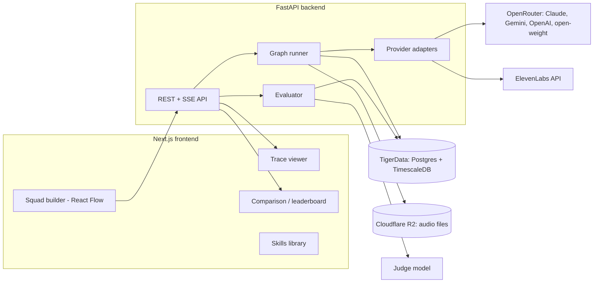

# LLMSquad — Project Structure (working name)

> **Problem statement:** Which AI team should do this job? Task-specific evaluation of multi-model AI squads.
>
> Teams now build AI systems from several models playing roles like planner, executor and verifier, but every leaderboard ranks single models on generic benchmarks. LLMSquad lets a user assemble squads of models (Claude, Gemini, OpenAI, open-weight models, plus non-LLM tools like ElevenLabs), wire how they talk to each other, run the same task on every squad, and see which squad performs best for the cost.

Status: design only. Nothing is implemented yet. Product name is not final.

---

## 1. Core concepts

| Concept | What it is |
|---|---|
| **Task** | The job the user wants done, plus optional test cases, a rubric, or an example of a good result. |
| **Squad** | A team: a directed graph of nodes connected by edges. |
| **Node** | One squad member. Either an **LLM node** or a **tool node**. |
| **LLM node** | A model (e.g. Claude Opus 5.5) + a role + a system prompt + attached skills. |
| **Tool node** | A non-LLM service (e.g. ElevenLabs text-to-speech) + its settings. |
| **Checkpoint node** | A human-in-the-loop stop. The run pauses here until a person approves, edits or rejects the incoming output. |
| **Role** | What the node does: planner, executor, debugger, reviewer, architect, database manager, data cleaner, etc. Users can add their own. |
| **Skill** | A reusable instruction block a user writes for their task and attaches to any LLM node. |
| **Edge** | A directed arrow: "send this node's output to that node." Dragging an arrow changes the communication direction. |
| **Session** | A saved squad configuration tied to the user's account (e.g. Session 1 = Gemini Flash planner, Haiku executor, Opus debugger, Opus reviewer). |
| **Run** | One execution of a session on a task. Stores every message, the final output and the scores. |
| **Fork** | A new run that starts from a chosen node of a finished run, reusing the saved outputs of every node before it. |
| **Evaluation** | Scores for a run: per-node usage and cost, LLM judge verdicts (per node and final), and human judge feedback. |

---

## 2. Features

### MVP (must have for the demo)
- Visual squad builder: drag nodes onto a canvas, pick model and role per node, connect with arrows.
- Drag an arrow to change who talks to whom.
- Role picker with presets plus custom roles.
- Multi-provider models through one gateway (Claude, Gemini, OpenAI, open-weight).
- Run a task on a squad; nodes run in graph order, parallel branches run concurrently.
- Save each squad as a session; run the same task on several sessions.
- Trace view: each node's input, output, tokens, cost and time, plus the full communication history.
- Final output view.
- **Per-node run analytics:** for every LLM, tool and checkpoint node — tokens used (input/output), cost, and time taken; plus run totals and each node's share of cost and time (see section 7c).
- **Task completion evaluation** (see section 9):
  - **LLM judge:** every node's output and the final output go to the judge, which scores how accurate each is and whether the task is complete.
  - **Human judge:** a person rates and writes feedback; an LLM reads that feedback, turns it into a structured verdict, and checks whether the feedback itself is useful.
- Test-case results for coding tasks.
- Comparison view: sessions ranked side by side.

### Chosen additions
- **Fork and replay from any node:** pick a node in a finished run, change its model, role, prompt or skills, and rerun from that node only. Earlier nodes' outputs are reused, so the comparison changes exactly one thing and costs less.
- **Human checkpoint nodes:** drop a checkpoint anywhere in the squad. The run pauses there; a person approves, edits or rejects the output before it continues. Each squad gets an "interventions needed" score.

### Stretch
- Skills library (create, edit, attach skills to any LLM node).
- ElevenLabs tool nodes (text-to-speech, speech-to-text) with typed audio/text ports.
- Weight sliders that re-rank sessions live (quality vs cost vs speed).
- Role attribution: swap one node's model and measure the score change.
- Real accounts with login.
- Repeat runs (3x) to measure reliability.

---

## 3. Architecture



---

## 4. Tech stack (proposed, not final)

| Layer | Choice | Why |
|---|---|---|
| Frontend | Next.js + TypeScript + Tailwind | Fast to build, easy to deploy |
| Graph canvas | React Flow | Drag, connect, re-route arrows out of the box |
| Backend | FastAPI (Python) + asyncio | Parallel node execution, easy LLM SDKs |
| Live updates | Server-Sent Events (SSE) | Stream node progress to the UI |
| LLM access | OpenRouter (or LiteLLM) | One key and one request format for every provider |
| Non-LLM tools | ElevenLabs API | TTS, STT, voice tools |
| Database | TigerData (Postgres + TimescaleDB) | Sessions, runs, skills; `node_results` and `messages` as hypertables; continuous aggregates for cost/time rollups |
| File storage | Cloudflare R2 (or local disk for the demo) | ElevenLabs audio files |
| Auth | Clerk (stretch) | Single local user for the demo |
| Judge | A strong model not used in the squads being judged | Reduces self-preference bias |

---

## 5. Folder structure

```
SquadVibeCheck/
├── README.md
├── PROJECT_STRUCTURE.md          # this file
├── .env.example                  # OPENROUTER_API_KEY, ELEVENLABS_API_KEY, DATABASE_URL (TigerData), R2 keys, CLERK keys, ...
│
├── frontend/                     # Next.js app
│   ├── app/
│   │   ├── page.tsx              # landing / session list
│   │   ├── builder/[sessionId]/page.tsx   # squad builder canvas
│   │   ├── runs/[runId]/page.tsx          # trace + final output
│   │   ├── compare/page.tsx               # leaderboard of sessions
│   │   └── skills/page.tsx                # skills library
│   ├── components/
│   │   ├── canvas/
│   │   │   ├── SquadCanvas.tsx   # React Flow wrapper
│   │   │   ├── LLMNode.tsx       # model + role + skills
│   │   │   ├── ToolNode.tsx      # ElevenLabs etc.
│   │   │   ├── CheckpointNode.tsx # human approval stop
│   │   │   └── TypedEdge.tsx     # arrow with text/audio type
│   │   ├── panels/
│   │   │   ├── NodeInspector.tsx # edit model, role, prompt, skills
│   │   │   ├── TaskPanel.tsx     # task, tests, rubric
│   │   │   └── RunControls.tsx
│   │   ├── trace/
│   │   │   ├── MessageTimeline.tsx
│   │   │   ├── NodeOutputCard.tsx    # output + tokens + cost + time + judge verdict
│   │   │   ├── ForkDialog.tsx        # "rerun from this node with..."
│   │   │   └── CheckpointPanel.tsx   # approve / edit / reject
│   │   ├── analytics/
│   │   │   ├── NodeUsageTable.tsx    # tokens, cost, time per node
│   │   │   └── CostBreakdownChart.tsx # share of cost and time per node
│   │   ├── evaluation/
│   │   │   ├── JudgeReport.tsx       # per-node + final accuracy
│   │   │   └── HumanFeedbackForm.tsx # rating + written feedback
│   │   └── compare/
│   │       ├── Leaderboard.tsx
│   │       └── WeightSliders.tsx
│   ├── lib/
│   │   ├── api.ts                # backend client
│   │   ├── types.ts              # shared types (mirror of backend schemas)
│   │   └── graphValidation.ts    # cycle + port-type checks in the UI
│   └── package.json
│
├── backend/                      # FastAPI app
│   ├── app/
│   │   ├── main.py
│   │   ├── config.py
│   │   ├── api/
│   │   │   ├── sessions.py
│   │   │   ├── runs.py
│   │   │   ├── skills.py
│   │   │   ├── models.py         # list available models + prices
│   │   │   └── evaluations.py
│   │   ├── core/
│   │   │   ├── graph.py          # validate graph, topological order, cycle caps
│   │   │   ├── runner.py         # execute a squad, emit messages, pause at checkpoints
│   │   │   ├── fork.py           # copy upstream results, rerun from a node
│   │   │   ├── metrics.py        # per-node tokens, cost, time; run totals
│   │   │   ├── pricing.py        # model + tool price table
│   │   │   ├── prompts.py        # build each node's prompt from role + skills + inputs
│   │   │   └── messages.py       # message format
│   │   ├── providers/
│   │   │   ├── base.py           # Provider interface
│   │   │   ├── openrouter.py     # all LLMs
│   │   │   └── elevenlabs.py     # TTS, STT
│   │   ├── evaluation/
│   │   │   ├── signals.py        # cost, latency, tokens, rounds
│   │   │   ├── tests.py          # sandboxed code test runner
│   │   │   ├── judge.py          # per-node + final accuracy, completion verdict
│   │   │   ├── human_feedback.py # LLM reads human feedback → structured verdict + quality check
│   │   │   ├── completion.py     # combine judge, human and tests into "complete / not complete"
│   │   │   └── audio.py          # STT round-trip accuracy
│   │   ├── db/
│   │   │   ├── client.py
│   │   │   └── schema.sql
│   │   └── schemas.py            # Pydantic models
│   ├── tests/
│   └── requirements.txt
│
└── demo/
    ├── tasks/                    # prepared demo tasks with tests/rubrics
    └── cached_runs/              # saved runs so the live demo doesn't depend on APIs
```

---

## 6. Data model

### Squad graph (stored as JSON on a session)
```json
{
  "nodes": [
    {
      "id": "n1",
      "kind": "llm",
      "label": "Planner",
      "role": "planner",
      "model": "google/gemini-flash-lite",
      "system_prompt": "You break the task into clear steps...",
      "skill_ids": ["sk_api_design"],
      "params": { "max_tokens": 1500, "temperature": 0.3 },
      "ports": { "in": ["text"], "out": ["text"] },
      "position": { "x": 100, "y": 200 }
    },
    {
      "id": "n5",
      "kind": "tool",
      "label": "Narrator",
      "tool": "elevenlabs.tts",
      "params": { "model": "eleven_v3", "voice_id": "..." },
      "ports": { "in": ["text"], "out": ["audio"] }
    },
    {
      "id": "n6",
      "kind": "checkpoint",
      "label": "Approve plan",
      "params": { "allow_edit": true, "timeout_minutes": 30, "on_timeout": "approve" },
      "ports": { "in": ["text"], "out": ["text"] }
    }
  ],
  "edges": [
    { "id": "e1", "source": "n1", "target": "n2", "type": "text" },
    { "id": "e4", "source": "n4", "target": "n2", "type": "text", "max_loops": 2 }
  ]
}
```

### Tables
| Table | Key fields |
|---|---|
| `users` | id, email, created_at |
| `skills` | id, user_id, name, description, instructions, created_at |
| `tasks` | id, user_id, title, description, task_type, test_cases (json), rubric (json), reference_output |
| `sessions` | id, user_id, name, graph (json), created_at, updated_at |
| `runs` | id, session_id, task_id, status (running / paused / done / failed), final_output, total_input_tokens, total_output_tokens, total_cost, total_latency_ms, **parent_run_id**, **forked_from_node**, graph_snapshot (json), started_at, finished_at |
| `messages` | id, run_id, seq, from_node, to_node, kind (text/audio), content or audio_url, created_at |
| `node_results` | id, run_id, node_id, node_kind, model_or_tool, input, output, input_tokens, output_tokens, cached_tokens, cost_usd, latency_ms, loop_index, reused_from_run_id (set when copied by a fork), status |
| `checkpoints` | id, run_id, node_id, status (waiting / approved / edited / rejected), original_output, edited_output, reviewer_note, wait_ms, decided_at |
| `judge_results` | id, run_id, node_id (null = final output), accuracy_score (0–10), complete (bool), issues (json), rationale, judge_model, judge_cost_usd |
| `human_feedback` | id, run_id, node_id (null = final output), rating (1–5), complete (bool), feedback_text, parsed_verdict (json), feedback_quality (useful / vague / contradictory), agrees_with_judge (bool) |
| `evaluations` | id, run_id, test_pass_rate, final_judge_score, human_score, completion_status, interventions_count, composite_score |
| `comparisons` | id, task_id, run_ids (json), pairwise_results (json), ranking (json) |

### Message format (the communication record)
```json
{
  "run_id": "r_123",
  "seq": 4,
  "from_node": "n2",
  "from_role": "executor",
  "to_node": "n3",
  "to_role": "debugger",
  "kind": "text",
  "content": "def parse_dates(...): ...",
  "input_tokens": 2100,
  "output_tokens": 850,
  "cost_usd": 0.0042,
  "latency_ms": 3200,
  "timestamp": "2026-10-10T15:30:00Z"
}
```

---

## 7. Communication and execution engine

The squad is a **directed graph**. Running it is a walk through the graph.

1. **Validate** the graph: every edge connects matching port types (text→text, audio→audio); at least one start node and one end node; cycles only where an edge has `max_loops`.
2. **Order** nodes topologically. Nodes with no incoming edges run first and receive the task.
3. **Build each node's input** = task + attached skills + labelled outputs from every node pointing into it (fan-in).
4. **Run** nodes whose inputs are ready; independent branches run in parallel with asyncio.
5. **Loops** (e.g. debugger → executor): allowed only with `max_loops` (default 2). The node can end the loop early by replying `APPROVED`.
6. **Log** every call as a message (see format above) and stream it to the UI over SSE.
7. **Final output** = output of the end node (no outgoing edges). If several, show all.

**Dragging an arrow** in the UI just edits `edges` in the session JSON. The next run follows the new direction. No special backend logic needed.

**Guardrails:** token cap per node, total cost cap per run, timeout per node, max loops per cycle.

### 7a. Human checkpoint nodes
1. When the runner reaches a checkpoint node, it saves the incoming output, sets the run to `paused`, and sends a `checkpoint_waiting` event over SSE.
2. The UI shows the checkpoint panel with three choices:
   - **Approve:** pass the output on unchanged.
   - **Edit:** pass the person's edited version on.
   - **Reject:** send the output back to the previous node with the person's note (counts as a loop, capped by `max_loops`), or stop the run.
3. The runner resumes from the checkpoint. Other branches that don't depend on it keep running while it waits.
4. Recorded per checkpoint: decision, edit diff, note, and wait time. Wait time is shown separately so human time doesn't count against the squad's speed.
5. **Interventions needed** = number of edits + rejects in the run. Lower is better.

### 7b. Fork and replay
1. In the trace view, the user clicks a node and chooses **Fork from here**.
2. They change that node's model, role, prompt, skills or tool settings (and optionally later nodes).
3. The backend creates a new run with `parent_run_id` and `forked_from_node`:
   - Every node **before** the fork point is copied from the parent run (`reused_from_run_id` set, cost counted as $0 for this run, original cost shown for reference).
   - The fork node and everything **after** it runs fresh.
4. The compare view shows parent and fork side by side, with a note of exactly what changed.
5. Forks can be forked again, building a tree of experiments per task.

---

## 7c. Run analytics (shown after every run)

For **every node** (LLM, tool and checkpoint) and for the **whole task**:

| Metric | LLM node | Tool node (e.g. ElevenLabs) | Checkpoint node |
|---|---|---|---|
| Input tokens | ✓ | — | — |
| Output tokens | ✓ | — | — |
| Cached tokens | ✓ | — | — |
| Units used | — | characters / audio seconds | — |
| Cost to perform ($) | tokens × model price | units × tool price | $0 |
| Time to perform | API call time (summed over loops) | API call time | human wait time (shown separately) |
| Loops / retries | ✓ | ✓ | rejects |

**Task totals:** total tokens, total cost, total wall-clock time (parallel branches overlap, so this is less than the sum of node times), human wait time, evaluation cost (judge calls, shown separately from the squad's cost).

**Cost analysis views:**
- Table of nodes sorted by cost, with each node's share of total cost and time.
- Bar chart: cost and time per node.
- Cost per successful task: total cost ÷ completion (from section 9).
- Session comparison: same table across sessions, so you can see which role drives the cost difference.
- Projected cost: cost per run × N runs (e.g. "1,000 runs/day ≈ $X").

Prices come from a `pricing.py` table loaded from the gateway's model list, with tool prices entered manually.

---

## 8. Provider adapters

```python
class Provider:
    async def run(self, node, inputs) -> NodeResult:
        # returns output (text or audio), tokens, cost, latency
```

| Adapter | Covers |
|---|---|
| `OpenRouterProvider` | Claude, Gemini, OpenAI, Kimi, DeepSeek, GLM, etc. |
| `ElevenLabsTTS` | Text → audio (v3, Multilingual v2, Flash v2.5, Turbo v2.5) |
| `ElevenLabsSTT` | Audio → text (Scribe) |
| `SandboxRunner` | Runs generated code against test cases (subprocess + timeout) |

Model list and prices are loaded from the gateway so cost is computed per call.

---

## 9. Evaluation

### Signals per run
| Category | Signal | How |
|---|---|---|
| Correctness | Test pass rate | Run test cases in a sandbox (coding tasks) |
| Quality | Rubric score 1–10 | LLM judge; rubric from the user or generated from the task |
| Relative quality | Pairwise wins / Elo | Judge compares two runs' outputs blind, both orders |
| Cost | $ per run | Tokens × price, plus tool charges |
| Speed | Wall-clock time | Start to final output |
| Reliability | Variance over repeats | Run 3x, report mean and spread (stretch) |
| Coordination | Loop count, critic catch rate | From the message log and judge |
| Audio (tool nodes) | Round-trip accuracy | TTS → STT → compare transcript to the script (word error rate) |
| Audio (optional) | Human rating 1–5 | Rating widget in the trace view |

| Human effort | Interventions needed | Edits + rejects at checkpoints (section 7a) |

### 9a. LLM as a judge (per node + final output)
After the run, the judge receives the task, the rubric or tests (if any), **every node's input and output**, and the **final output**.

For **each node** it returns:
```json
{
  "node_id": "n3",
  "role": "debugger",
  "accuracy_score": 6,
  "did_its_job": false,
  "issues": ["Approved code that fails 2 of 5 tests", "Missed off-by-one in loop"],
  "rationale": "..."
}
```
For the **final output** it returns:
```json
{
  "accuracy_score": 7,
  "complete": true,
  "missing": ["No handling for empty input"],
  "rationale": "..."
}
```
Notes:
- One judge call per node can get expensive; batch all node outputs into one call for small squads, split for large ones.
- Judge cost is tracked separately from the squad's cost.
- Bias controls (below) apply.

### 9b. Human judge
1. After the run, the person gives a **rating (1–5)**, ticks **complete / not complete**, and writes **free-text feedback** — on the final output and optionally on any node.
2. An LLM reads the feedback and produces a structured verdict:
   ```json
   {
     "sentiment": "negative",
     "complete": false,
     "issues": ["Summary skips the pricing section", "Too long"],
     "blamed_nodes": ["n2"],
     "feedback_quality": "useful",
     "agrees_with_judge": false
   }
   ```
3. **Is the feedback good?** The LLM rates the feedback itself:
   - `useful`: specific, actionable, points to what's wrong.
   - `vague`: "not great", "fine" — kept, but weighted lower.
   - `contradictory`: rating and text disagree (e.g. 5 stars, "this is wrong") — flagged and the user is asked to confirm.
4. **Agreement with the LLM judge** is recorded per run. Over many runs this shows how far the judge can be trusted on this task; big disagreement means the rubric or judge needs fixing.
5. Useful feedback can be sent to the squad as input for a **fork** (section 7b), so the person's feedback directly drives the next attempt.

### 9c. When is a task "complete"?
| Source | Counts as complete when |
|---|---|
| Tests (if provided) | All required tests pass |
| LLM judge | `complete = true` and final accuracy ≥ threshold (default 7/10) |
| Human judge (if given) | Marked complete, or rating ≥ 4 |

Rule: **human verdict overrides the judge** when present; tests override both for coding tasks. The run is labelled `complete`, `partial` or `failed`, and the reason is shown.

### Composite score
```
score = w_quality * final_accuracy + w_tests * test_pass_rate + w_human * human_score
        - w_cost * normalized_cost - w_speed * normalized_latency
        - w_effort * interventions_needed
```
Weights are sliders in the comparison view; the leaderboard re-ranks live.

### Bias controls
- Judge model is not a member of any squad being compared.
- Pairwise judging runs in both orders.
- Objective tests are preferred over judge scores when available.
- Optional jury: 2–3 judges from different providers, average the scores.

---

## 10. API endpoints

| Method | Path | Purpose |
|---|---|---|
| GET | `/models` | Available models, tools and prices |
| GET/POST | `/sessions` | List / create sessions |
| GET/PUT/DELETE | `/sessions/{id}` | Read / update graph / delete |
| POST | `/sessions/{id}/validate` | Check graph (ports, cycles) |
| GET/POST | `/tasks` | List / create tasks |
| POST | `/runs` | Start a run `{session_id, task_id}` |
| GET | `/runs/{id}` | Run status, final output, totals |
| GET | `/runs/{id}/stream` | SSE stream of messages while running |
| GET | `/runs/{id}/messages` | Full communication history |
| GET | `/runs/{id}/metrics` | Per-node tokens, cost, time + run totals |
| POST | `/runs/{id}/fork` | Start a fork `{from_node_id, node_changes}` |
| GET | `/runs/{id}/forks` | Fork tree for a run |
| GET | `/runs/{id}/checkpoints` | Waiting / decided checkpoints |
| POST | `/runs/{id}/checkpoints/{node_id}` | Decide `{action: approve/edit/reject, edited_output, note}` |
| POST | `/runs/{id}/evaluate` | Run the LLM judge (per node + final) |
| POST | `/runs/{id}/feedback` | Submit human feedback `{node_id?, rating, complete, text}` |
| GET | `/runs/{id}/evaluation` | Judge results, human verdict, completion status |
| POST | `/compare` | Rank several runs of the same task |
| GET/POST/PUT/DELETE | `/skills` | Skills library |

---

## 11. UI screens

1. **Sessions home:** list of saved sessions and recent runs.
2. **Squad builder:** canvas with nodes and arrows; side panel to set model, role, prompt and skills; node palette (LLM roles + ElevenLabs tools); task panel; Run button.
3. **Live run view:** nodes light up as they run; messages stream into a timeline; a checkpoint node pulses and opens the approve / edit / reject panel when the run pauses.
4. **Trace view:** click any node to see its input, output, tokens, cost, time and judge verdict; full message timeline; final output; **Fork from here** button on every node.
5. **Analytics panel:** per-node usage table (tokens, cost, time, loops), cost and time share chart, task totals, cost per successful task, projected cost.
6. **Evaluation panel:** judge accuracy per node and for the final output, completion status with reason, human feedback form, and the LLM's read of that feedback (quality + agreement with the judge).
7. **Compare view:** leaderboard of sessions on the same task; weight sliders; side-by-side outputs; fork tree showing what changed between parent and fork.
8. **Skills library:** create and edit skills; attach them to nodes from the builder.

---

## 12. Example sessions for the demo

| Session | Planner | Executor | Debugger | Reviewer |
|---|---|---|---|---|
| 1 | Gemini Flash (lite) | Claude Haiku 5.5 | Claude Opus 5.5 | Claude Opus 5.5 |
| 2 | Claude Fable 5.1 | Claude Opus 5.5 | Claude Sonnet 5.5 | GPT model |
| 3 | Claude Haiku 5.5 | Claude Haiku 5.5 | Claude Haiku 5.5 | Claude Haiku 5.5 (cheap baseline) |

Audio demo squad: Planner → Script writer → ElevenLabs TTS → ElevenLabs STT → Verifier. Session B swaps only the TTS model.

---

## 13. Budget

- Build and debug with cheap models (Haiku 5.5 / Flash-tier): ~$5.
- Real comparison runs with top models mixed in: ~$70–120.
- Demo + buffer: ~$20–30.
- Use prompt caching, token caps and cached demo runs to stay in budget.

---

## 14. Build plan

| Order | Milestone |
|---|---|
| 1 | Repo setup, env keys, OpenRouter call works |
| 2 | Squad builder canvas: nodes, role/model pickers, arrows |
| 3 | Graph validation + runner + message logging + per-node metrics (tokens, cost, time) |
| 4 | Save sessions; run a task; trace view; analytics panel |
| 5 | LLM judge (per node + final) + test runner + completion status |
| 6 | Human feedback form + LLM feedback parsing and quality check |
| 7 | Human checkpoint nodes (pause / resume) |
| 8 | Fork and replay from any node |
| 9 | Compare view with leaderboard, weight sliders and fork tree |
| 10 | Skills library |
| 11 | ElevenLabs tool nodes + audio round-trip eval |
| 12 | Auth, repeat runs |
| 13 | Cache demo runs, rehearse pitch |

---

## 15. Risks

| Risk | Mitigation |
|---|---|
| API cost and rate limits | Cheap models for dev, caps per node/run, cached demo runs |
| Slow runs | Parallel branches, short tasks, streaming UI |
| Infinite loops between nodes | `max_loops` on cycle edges, early `APPROVED` exit |
| Judge bias | Outside judge, both-order pairwise, prefer tests |
| Non-deterministic results | Repeat runs, report variance |
| Unsafe generated code | Sandboxed subprocess with timeout, no network |
| Run stuck at a checkpoint | Checkpoint timeout with a default action; other branches keep running |
| Fork reuses stale upstream output | Store a graph snapshot per run; fork only from completed nodes |
| Judge cost grows with squad size | Batch node outputs into one judge call; cheaper judge for per-node checks |
| Low-quality human feedback | LLM flags vague / contradictory feedback and weights it lower |

---

## 16. Open decisions

- [ ] Final product name
- [ ] Stack confirmation (Python backend vs all TypeScript)
- [ ] Which API keys are available (OpenRouter, Anthropic, Google, OpenAI, ElevenLabs)
- [ ] Login in the demo, or single local user
- [ ] Team split (who builds frontend, backend, evaluation)
- [ ] Which 2–3 demo tasks to prepare

---

## 17. Diagrams

PNG exports live in `diagrams/` (editable originals are in Lucidchart).

| File | Shows |
|---|---|
| `diagrams/1-system-architecture.png` | Frontend, FastAPI services, model providers, TigerData, R2, optional Clerk |
| `diagrams/2-squad-run-lifecycle.png` | Validate → run nodes → checkpoints and loops → judge → human feedback → complete or fork |
| `diagrams/3-run-checkpoint-evaluation-sequence.png` | Request-by-request flow of a run, a checkpoint pause, and evaluation |
| `diagrams/4-fork-and-replay-sequence.png` | How a fork reuses upstream results and reruns from one node |
| `diagrams/5-data-model-erd.png` | Tables and relationships; hypertables marked |
