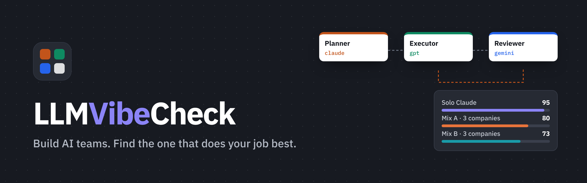
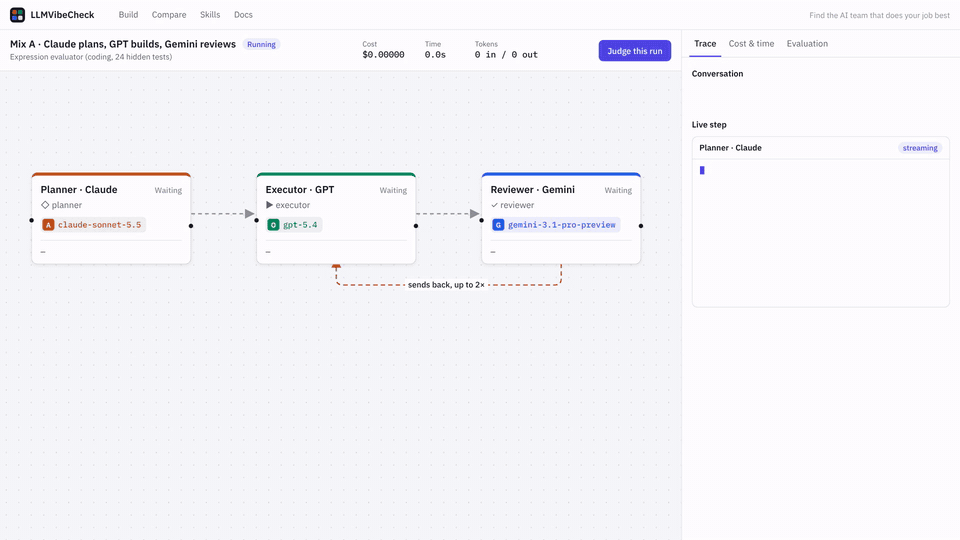
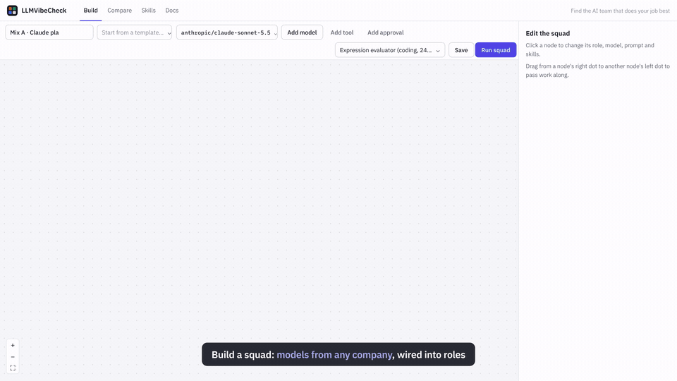
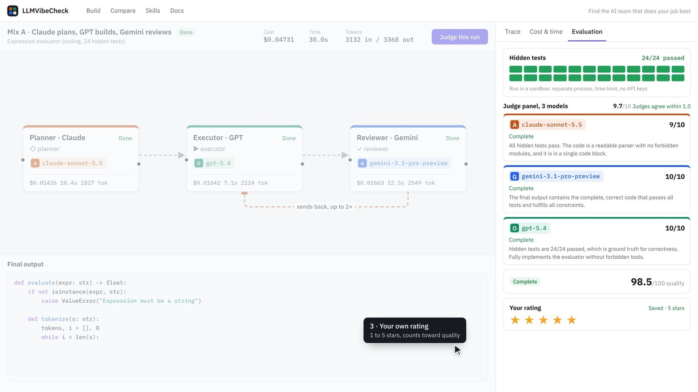
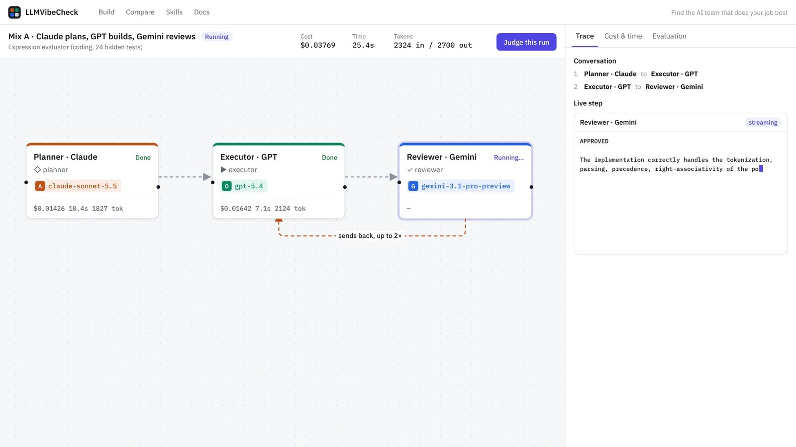
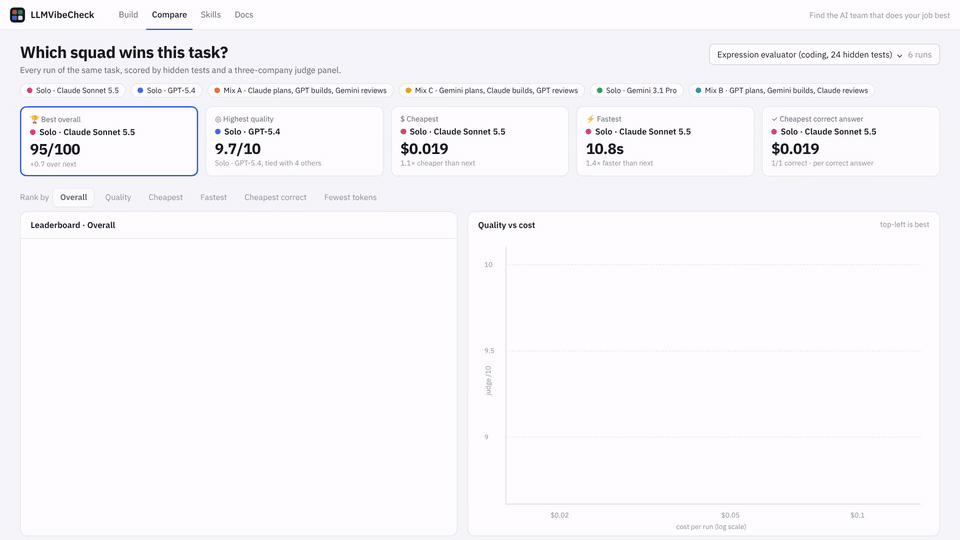
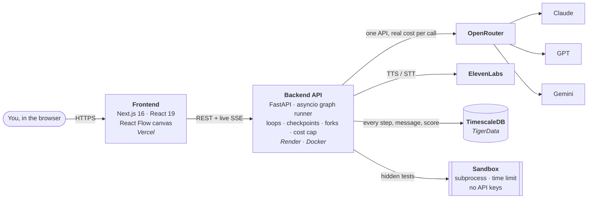

<p align="center">
  
</p>

<p align="center">
  <a href="https://llmvibecheck.vercel.app"></a>
  
  
</p>

<p align="center">
  
  
  
  
  
  
  
</p>

<h3 align="center">Which AI team should do this job?</h3>

<p align="center">
Put models from different companies into roles, run them on the <b>same task</b>,<br>
and see which team gets it right for the <b>least money and time</b>.
</p>

<p align="center">
  
</p>

---

## Why

Real work is increasingly done by **teams of models**: one plans, one builds, one reviews. Picking the team is still guesswork:

- Is Claude + GPT + Gemini better than one strong model on its own?
- Is a cheap model with a strict reviewer good enough?
- What does each choice really cost, in dollars and seconds?

**LLMVibeCheck answers with evidence.** Every team runs the same task, gets the same hidden tests and the same judges, and lands on one leaderboard.

## How it works

| | Step | What happens |
|:-:|---|---|
| **1** | **Build a squad** | Drag models from any company into roles (planner, executor, reviewer, or your own) on a visual canvas. Add loops, reusable skills, human checkpoints and voice steps. |
| **2** | **Run it** | Pick a task. Every step streams in live with its prompt, answer, tokens, cost and time. |
| **3** | **Evaluate it** | Hidden tests in a sandbox, a judge panel from three companies, and an optional human rating. |
| **4** | **Compare** | One 0–100 score per run. Rank squads by overall, quality, cost, speed or *cheapest correct answer*. |

<table>
  <tr>
    <td width="50%"><br><sub><b>Build:</b> wire Claude, GPT and Gemini into roles, with a review loop.</sub></td>
    <td width="50%"><br><sub><b>Evaluate:</b> 24/24 hidden tests and three judges from three companies.</sub></td>
  </tr>
  <tr>
    <td width="50%"><br><sub><b>Run:</b> every step streams live with cost, time and tokens.</sub></td>
    <td width="50%"><br><sub><b>Compare:</b> re-rank by cost, speed or cheapest correct answer.</sub></td>
  </tr>
</table>

## What we found

We gave six squads the same task, an arithmetic expression evaluator with **24 hidden tests**: three cross-company squads and three solo models.

| Rank | Squad | Tests | Judges | Cost | Time | Overall |
|:-:|---|:-:|:-:|--:|--:|--:|
| 🥇 | **Solo · Claude Sonnet 5.5** | 24/24 | 9.0 | **$0.019** | **10.8s** | **95.0** |
| 2 | Solo · GPT-5.4 | 24/24 | 9.7 | $0.020 | 15.4s | 94.3 |
| 3 | Mix A · Claude plans → GPT builds → Gemini reviews | 24/24 | 9.7 | $0.047 | 30.0s | 80.4 |
| 4 | Mix C · Gemini plans → Claude builds → GPT reviews | 24/24 | 9.3 | $0.043 | 32.5s | 79.2 |
| 5 | Solo · Gemini 3.1 Pro | 24/24 | 9.7 | $0.070 | 53.9s | 76.3 |
| 6 | Mix B · GPT plans → Gemini builds → Claude reviews | 24/24 | 9.7 | $0.121 | 90.7s | 73.2 |

> **More models ≠ better results.** Every squad was correct, but Mix B cost **6.4×** the winner because its reviewer kept sending work back. That's exactly the kind of insight this tool exists to surface.

## Features

- **Visual squad builder** (React Flow): any model in any role, drag arrows to set who talks to whom, loop edges with a max-rounds limit
- **Reusable skills** attached to any step, like a coding style guide
- **Graph runner**: parallel branches, feedback loops, and **human checkpoints** (approve / edit / reject)
- **Live streaming** over server-sent events, with per-step tokens, cost and latency
- **Fork and replay** from any step: upstream results are reused at $0
- **Hidden tests** run in a sandboxed subprocess with a time limit and no API keys
- **Judge panel** of Claude, GPT and Gemini, so no model grades only its own family; we also report how much they disagree
- **Compare view** with six ranking modes and a quality-vs-cost chart
- **Voice steps** with ElevenLabs text-to-speech and speech-to-text
- **Safety rails**: a $2 hard cost cap per run, and a plain-language Docs page for non-technical users

## How scoring works

Quality uses whatever signals exist for a run:

$$
Q = \frac{w_j \cdot 10J \;+\; w_t \cdot 100T \;+\; w_h \cdot H}{w_j + w_t + w_h}
$$

$J$ is the judge panel mean (0–10), $T$ the hidden-test pass rate (0–1), and $H$ the human rating mapped to 0–100. Cost and speed are scored relative to the best squad on the same task. The overall score then reduces quality by the efficiency penalty:

$$
\text{Overall} = Q \cdot \bigl(1 - \min(1,\; 0.2\,\Delta_{\text{cost}} + 0.1\,\Delta_{\text{speed}} + 0.1\,\Delta_{\text{effort}})\bigr)
$$

So a cheap but wrong squad can **never** beat a correct one, and nothing leaves the 0–100 range.
**Cheapest correct answer** = average cost ÷ success rate.

## Architecture



More diagrams (run lifecycle, checkpoint and evaluation sequence, fork and replay, data model) are in [`diagrams/`](diagrams/). The full design is in [`PROJECT_STRUCTURE.md`](PROJECT_STRUCTURE.md).

## Run it locally

**You need:** Python 3.12, Node 20+, Docker, and an [OpenRouter](https://openrouter.ai) API key. An ElevenLabs key is optional and only needed for voice steps.

```bash
# 1. Database: TimescaleDB in Docker
docker run -d --name squad-db -p 5433:5432 -e POSTGRES_PASSWORD=squad \
  -v squad-db-data:/var/lib/postgresql/data timescale/timescaledb:latest-pg16

# 2. Backend (terminal 1): http://localhost:8000
cp .env.example .env          # then fill in your keys
cd backend
python3 -m venv .venv && source .venv/bin/activate
pip install -r requirements.txt
python -m app.db.migrate
uvicorn app.main:app --reload --port 8000

# 3. Frontend (terminal 2): http://localhost:3000
cd frontend
npm install && npm run dev

# 4. Optional (terminal 3, backend venv active): demo squads and tasks
python demo/seed.py
```

<details>
<summary><b>Environment variables</b></summary>

| Variable | Required | What it does |
|---|:-:|---|
| `OPENROUTER_API_KEY` | ✅ | One key for every model company |
| `DATABASE_URL` | ✅ | Postgres / TimescaleDB connection string |
| `ELEVENLABS_API_KEY` | | Voice steps (TTS / STT) |
| `ALLOWED_ORIGINS` | | Frontend URLs allowed to call the API (comma-separated) |
| `JUDGE_PANEL` | | Comma-separated judge models (default: Claude, GPT, Gemini) |
| `RUN_COST_CAP_USD` | | Hard stop per run (default `2.0`) |
| `NEXT_PUBLIC_API_URL` | | Frontend → backend URL (default `http://localhost:8000`) |

</details>

## Tests

```bash
cd backend && python -m pytest -q     # 116 tests, no API calls, no database needed
```

They cover the graph runner, loops and checkpoints, the test sandbox (including tamper-resistance), judge-panel aggregation, scoring bounds, pricing and the API routes.

## Deploy

Frontend on **Vercel**, backend on **Render** (one-click [`render.yaml`](render.yaml) Blueprint), database on **TigerData**. Step-by-step guide: [`DEPLOY.md`](DEPLOY.md).

## Project structure

```
backend/
  app/
    api/          REST + SSE routes (runs, compare, evaluation, skills)
    core/         graph validation, squad runner, run manager
    evaluation/   tests sandbox, judge panel, scoring, completion rule
    providers/    OpenRouter, ElevenLabs, live pricing
    db/           connection pool, schema, migrations
  tests/          116 unit tests
  scripts/        smoke tests, data copy to the cloud
frontend/src/
  app/            Home, Builder, Run, Compare, Skills, Docs pages
  components/     squad canvas, node inspector, shared UI
demo/tasks/       ready-made tasks with hidden tests
diagrams/         architecture and sequence diagrams
```

## What's next

- [ ] Repeat runs with confidence intervals, so rankings reflect consistency, not luck
- [ ] A benchmark library of tasks: coding, writing, data extraction, tool-using agents
- [ ] Auto-search: given a task and a budget, find the best squad automatically
- [ ] Shareable public leaderboards

---

<p align="center">
  Built at <b>HackRU 2026</b> by <a href="https://github.com/tanmaykatke21">Tanmay Katke</a><br>
  <sub>Check the vibe before you trust an AI team with your job.</sub>
</p>
